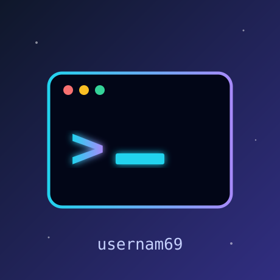

  

  # Hi, I'm usernam69 👋

  *Developer · Tinkerer · Always learning*

## 🚀 About Me
- 🔭 Building small projects and experimenting with new tools
- 🌱 Currently learning more about software development and AI
- 💬 Ask me about anything code-related
- ⚡ Fun fact: I let an AI write this README

## 🛠️ Tech I Use

## 📊 GitHub Stats

  

## 📫 Connect

